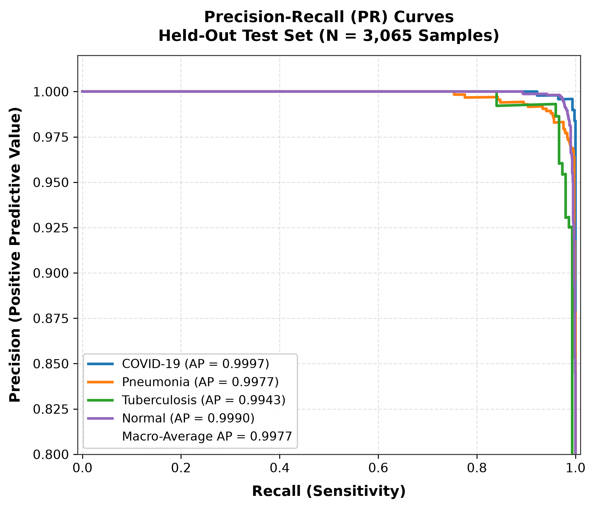
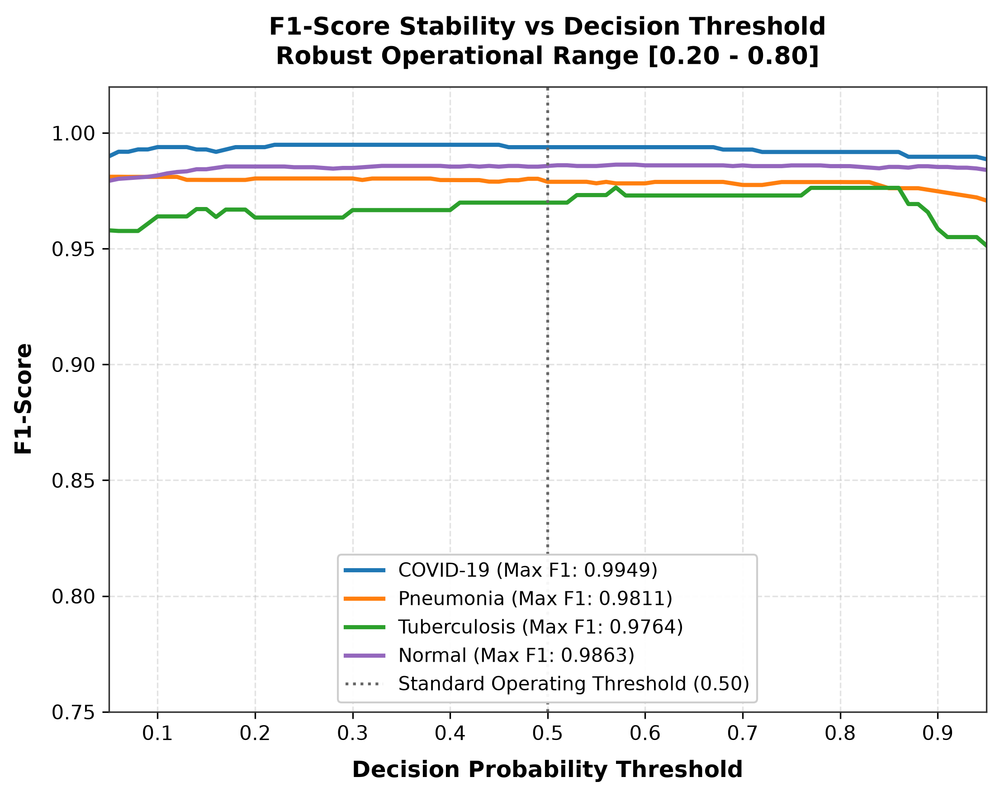

# Final Evaluation Figures (Publication-Ready)

This directory contains standalone, high-resolution (300 DPI) figures for the **DyDA Dynamic Data Augmentation + EfficientNet-B0** multiclass pulmonary disease diagnostic model.

All figures were generated from the held-out clinical test set ($N = 3,065$ radiographs) and the winning 3-fold cross-validation checkpoint (Fold 2, Best Checkpoint at Epoch 9).

---

## 📁 Figure Index

| # | File Name | Description | Key Metric |
|---|---|---|---|
| **01** | [`01_final_confusion_matrix_normalized.png`](01_final_confusion_matrix_normalized.png) | Row-normalized confusion matrix with per-cell recall % and sample counts $(n)$ | **98.43% Overall Accuracy** |
| **02** | [`02_final_confusion_matrix_raw_counts.png`](02_final_confusion_matrix_raw_counts.png) | Raw integer confusion matrix across all 3,065 test cases | **3,017 / 3,065 Correct** |
| **03** | [`03_final_roc_auc_curves.png`](03_final_roc_auc_curves.png) | One-vs-Rest Receiver Operating Characteristic (ROC) curves with per-class and macro AUC | **0.9994 Macro ROC-AUC** |
| **04** | [`04_final_precision_recall_curves.png`](04_final_precision_recall_curves.png) | Precision-Recall (PR) curves with Average Precision (AP) per class and macro-average | **0.9977 Macro AP** |
| **05** | [`05_final_f1_score_vs_threshold_curves.png`](05_final_f1_score_vs_threshold_curves.png) | F1-score stability across decision probability thresholds $[0.05, 0.95]$ | **Stable $[0.20 - 0.80]$** |
| **06** | [`06_training_validation_loss_curve.png`](06_training_validation_loss_curve.png) | Standalone Training and Validation Cross-Entropy Loss curve across 10 epochs | **Min Val Loss: 0.0739** |
| **07** | [`07_training_validation_accuracy_curve.png`](07_training_validation_accuracy_curve.png) | Standalone Training and Validation Accuracy progression across 10 epochs | **Peak Val Acc: 98.78%** |
| **08** | [`08_validation_macro_f1_curve.png`](08_validation_macro_f1_curve.png) | Validation Macro-F1 and Balanced Accuracy curves (Model checkpoint selection metric) | **Peak Macro-F1: 98.10%** |
| **09** | [`09_per_class_diagnostic_metrics_bar.png`](09_per_class_diagnostic_metrics_bar.png) | Grouped bar chart comparing Precision, Sensitivity, Specificity, and F1 per disease | **96.7% - 99.9% Per Class** |

---

## 1. Confusion Matrix (Normalized)

## 2. Confusion Matrix (Raw Counts)

## 3. ROC-AUC Curves

## 4. Precision-Recall Curves

## 5. F1-Score vs Decision Threshold

## 6. Training & Validation Loss Curve

## 7. Training & Validation Accuracy Curve

## 8. Validation Macro-F1 Curve

## 9. Per-Class Diagnostic Performance

---

## 📊 Summary Performance Table on Held-Out Test Split ($N = 3,065$)

| Disease Class | Support | Precision | Recall (Sensitivity) | Specificity | F1-Score | ROC-AUC |
|---|---|---|---|---|---|---|
| **COVID-19** | 488 | **99.59%** | **99.18%** | 99.92% | **99.38%** | **0.9999** |
| **Pneumonia** | 780 | **97.70%** | **98.08%** | 99.21% | **97.89%** | **0.9992** |
| **Tuberculosis** | 150 | **97.32%** | **96.67%** | 99.86% | **96.99%** | **0.9995** |
| **Normal** | 1,647 | **98.54%** | **98.54%** | 98.31% | **98.54%** | **0.9988** |
| **Macro Average** | **3,065** | **98.29%** | **98.12%** | **99.33%** | **98.20%** | **0.9994** |
