# Final Evaluation Figures (Publication-Ready)

This directory contains standalone, high-resolution (300 DPI) figures for the **DyDA Dynamic Data Augmentation + EfficientNet-B0** multiclass pulmonary disease diagnostic model.

All figures were generated from the held-out clinical test set ($N = 3,065$ radiographs) and the winning cross-validation checkpoint (Fold 2, Best Checkpoint at Epoch 9).

---

## 📁 Figure Index

### Confusion Matrices
| # | File Name | Description | Key Metric |
|---|---|---|---|
| **01** | [`01_final_confusion_matrix_normalized.png`](01_final_confusion_matrix_normalized.png) | Row-normalized confusion matrix with per-cell recall % and sample counts $(n)$ | **98.43% Overall Accuracy** |
| **02** | [`02_final_confusion_matrix_raw_counts.png`](02_final_confusion_matrix_raw_counts.png) | Raw integer confusion matrix across all 3,065 test cases | **3,017 / 3,065 Correct** |

### Individual Class AUC ROC Curves (Per-Disease Standalone)
| # | File Name | Target Condition | Area Under Curve (AUC) | Test Support |
|---|---|---|---|---|
| **03a** | [`03a_final_roc_auc_COVID-19.png`](03a_final_roc_auc_COVID-19.png) | **COVID-19** | **AUC = 0.9999** | $N = 488$ |
| **03b** | [`03b_final_roc_auc_Pneumonia.png`](03b_final_roc_auc_Pneumonia.png) | **Pneumonia** | **AUC = 0.9992** | $N = 780$ |
| **03c** | [`03c_final_roc_auc_Tuberculosis.png`](03c_final_roc_auc_Tuberculosis.png) | **Tuberculosis** | **AUC = 0.9995** | $N = 150$ |
| **03d** | [`03d_final_roc_auc_Normal.png`](03d_final_roc_auc_Normal.png) | **Normal (Healthy Controls)** | **AUC = 0.9988** | $N = 1,647$ |
| **03** | [`03_final_roc_auc_curves_all_classes.png`](03_final_roc_auc_curves_all_classes.png) | **Combined Multiclass ROC** | **Macro AUC = 0.9994** | $N = 3,065$ |

### Precision-Recall Curves (Combined & Per-Class)
| # | File Name | Description | Key Metric |
|---|---|---|---|
| **04** | [`04_final_precision_recall_curves_all_classes.png`](04_final_precision_recall_curves_all_classes.png) | Combined Precision-Recall (PR) curves across all 4 classes | **Macro AP = 0.9977** |
| **04a** | [`04_covid-19_precision_recall_curve.png`](04_covid-19_precision_recall_curve.png) | Individual PR curve for **COVID-19** | **AP = 0.9997** |
| **04b** | [`04_pneumonia_precision_recall_curve.png`](04_pneumonia_precision_recall_curve.png) | Individual PR curve for **Pneumonia** | **AP = 0.9977** |
| **04c** | [`04_tuberculosis_precision_recall_curve.png`](04_tuberculosis_precision_recall_curve.png) | Individual PR curve for **Tuberculosis** | **AP = 0.9943** |
| **04d** | [`04_normal_precision_recall_curve.png`](04_normal_precision_recall_curve.png) | Individual PR curve for **Normal** | **AP = 0.9990** |
| **05** | [`05_final_f1_score_vs_threshold_curves.png`](05_final_f1_score_vs_threshold_curves.png) | F1-Score stability across decision probability thresholds $[0.05, 0.95]$ | **Stable $[0.20 - 0.80]$** |

### Training Progression & Diagnostic Metric Bar Charts
| # | File Name | Description | Key Metric |
|---|---|---|---|
| **06** | [`06_training_validation_loss_curve.png`](06_training_validation_loss_curve.png) | Standalone Training and Validation Cross-Entropy Loss curve | **Min Val Loss: 0.0739** (Epoch 4) |
| **07** | [`07_training_validation_accuracy_curve.png`](07_training_validation_accuracy_curve.png) | Standalone Training and Validation Accuracy progression | **Peak Val Acc: 98.78%** (Epoch 9) |
| **08** | [`08_validation_macro_f1_curve.png`](08_validation_macro_f1_curve.png) | Validation Macro-F1 & Balanced Accuracy checkpoint selection curve | **Peak Macro-F1: 98.10%** (Epoch 9) |
| **09** | [`09_per_class_diagnostic_metrics_bar.png`](09_per_class_diagnostic_metrics_bar.png) | Grouped bar chart comparing Precision, Sensitivity, Specificity, and F1 | **96.7% - 99.9% Per Class** |

---

## 🖼️ Previews

### 1. Confusion Matrix (Row-Normalized)
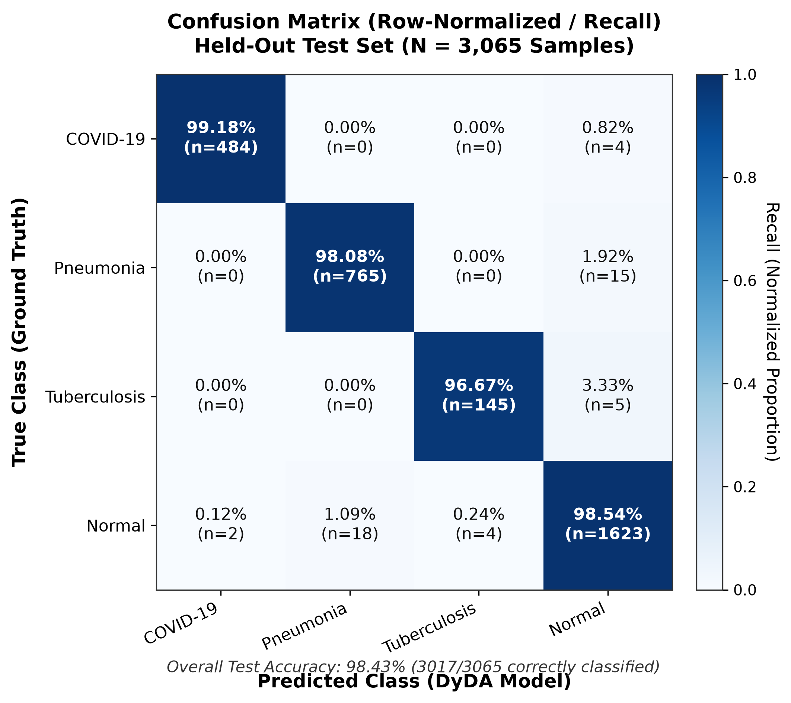

### 2. Confusion Matrix (Raw Case Counts)
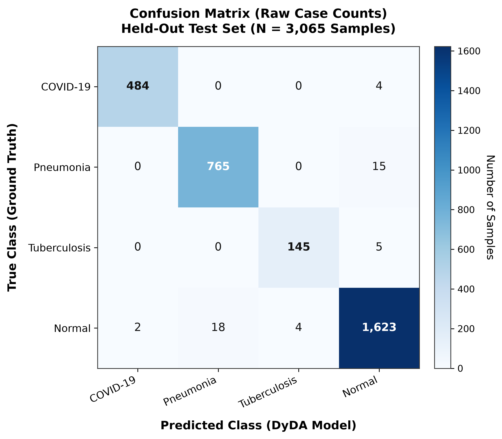

### 3. Individual AUC ROC Curves
#### 3a. COVID-19 (AUC = 0.9999)
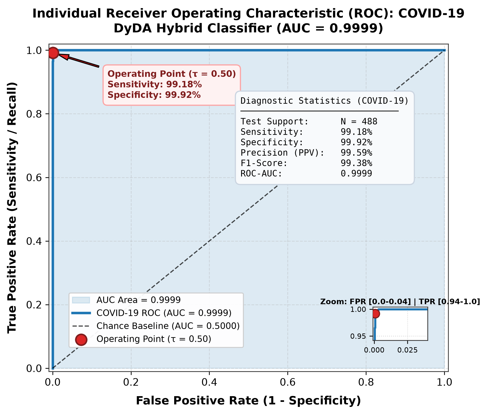

#### 3b. Pneumonia (AUC = 0.9992)
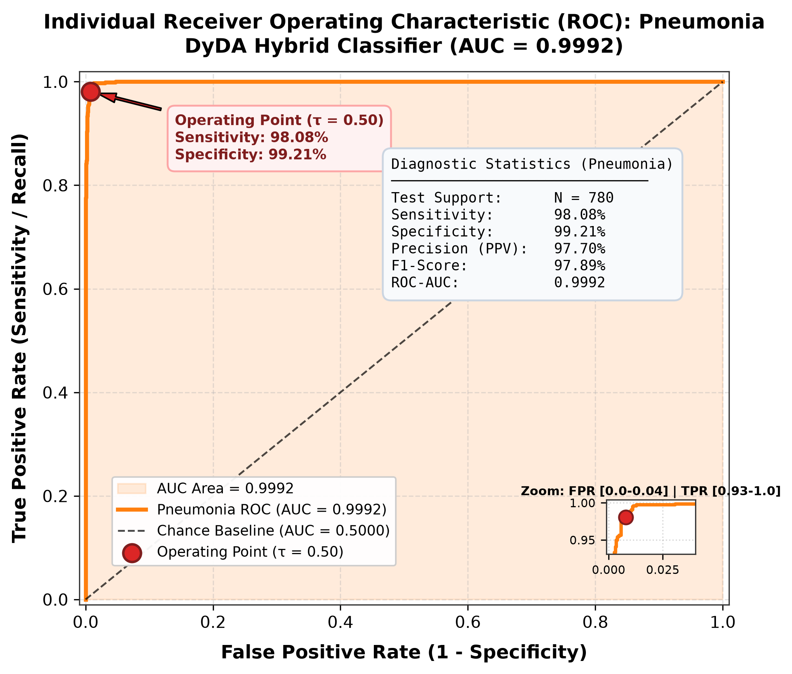

#### 3c. Tuberculosis (AUC = 0.9995)
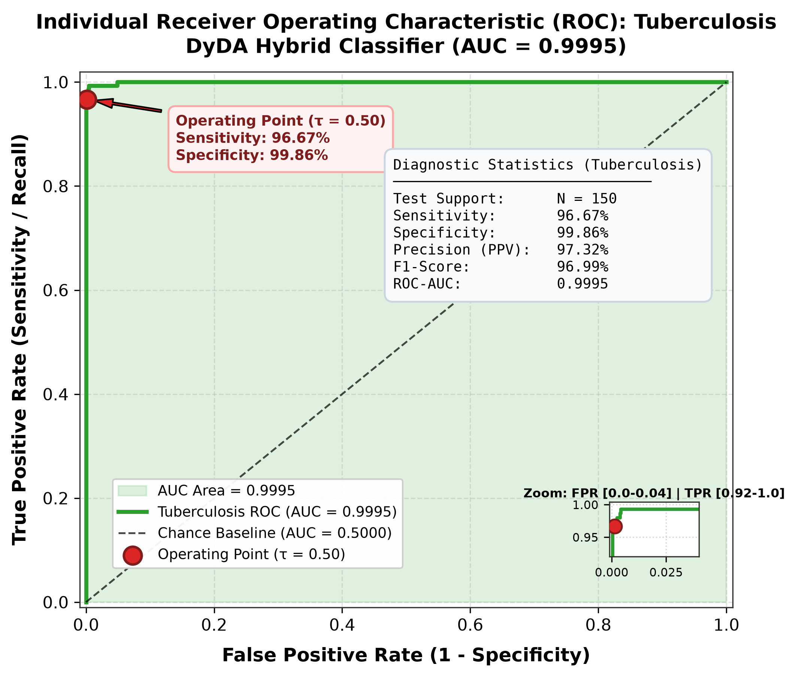

#### 3d. Normal (AUC = 0.9988)
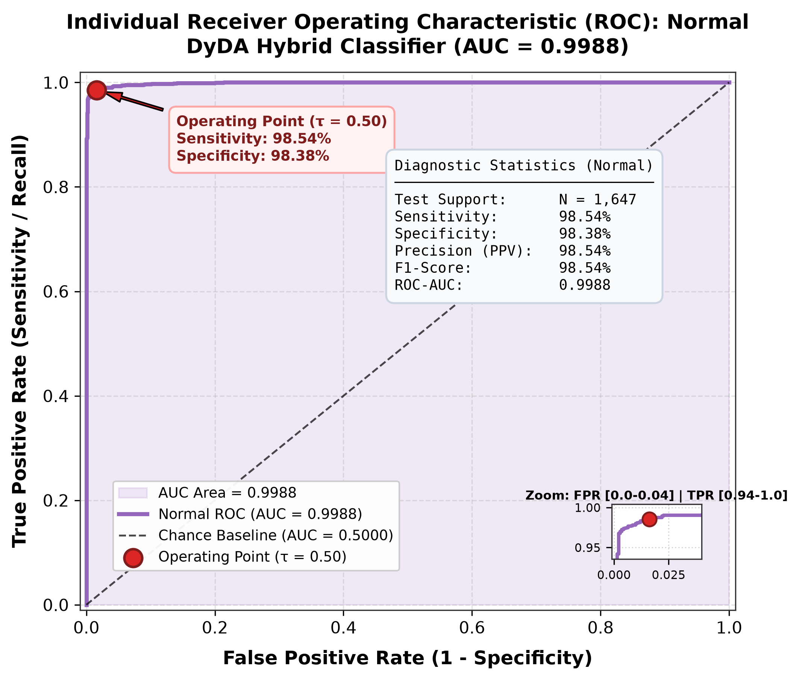

#### 3e. Combined Multiclass ROC Curves
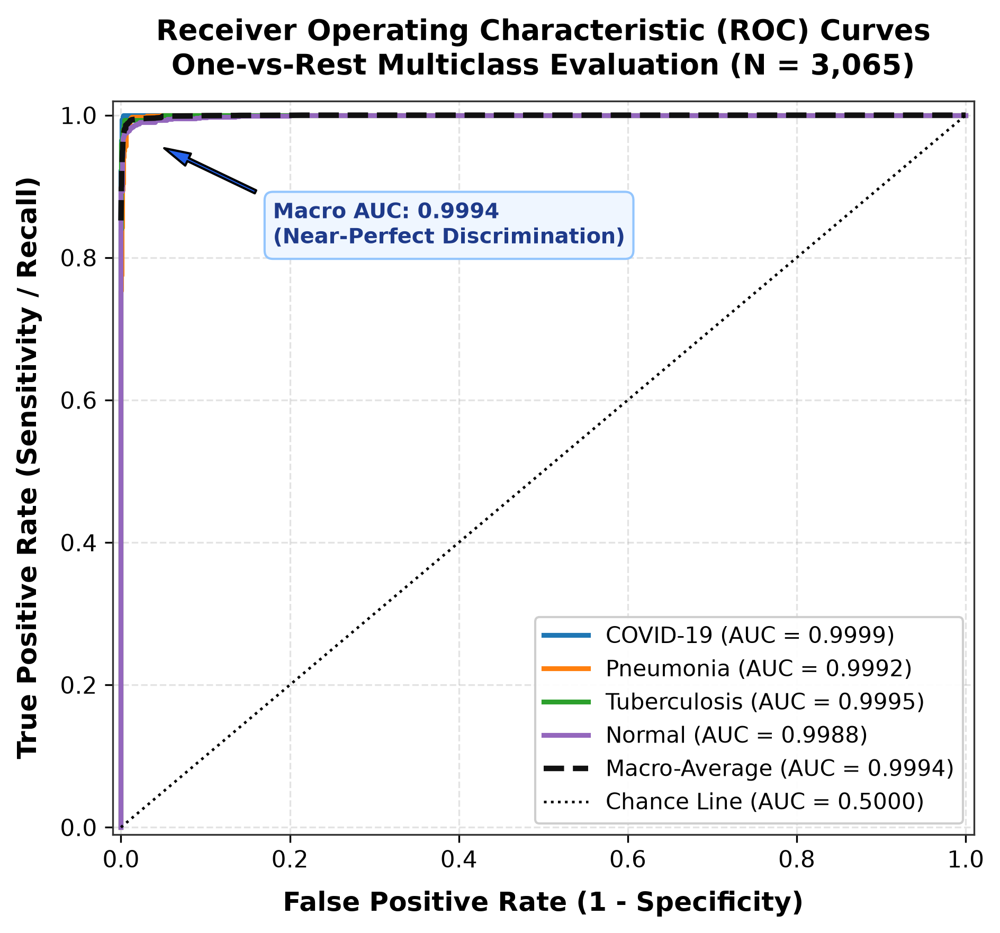

### 4. Training, Validation, and Metric Curves
#### 4a. Standalone Training and Validation Loss Curve
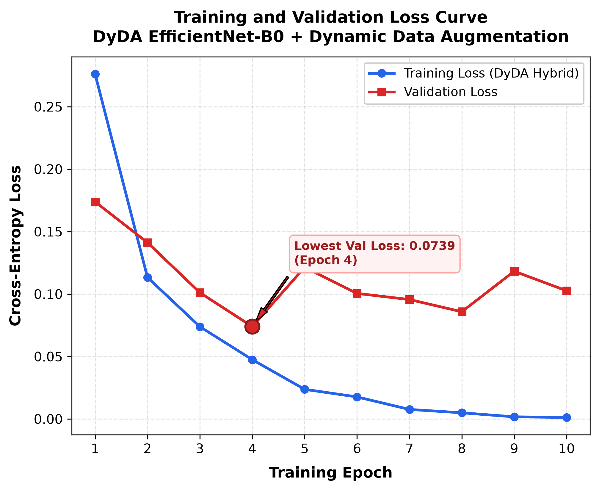

#### 4b. Standalone Training and Validation Accuracy Curve
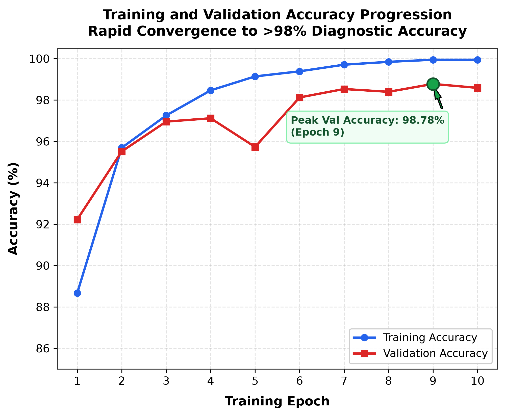

#### 4c. Standalone Validation Macro-F1 Progression Curve
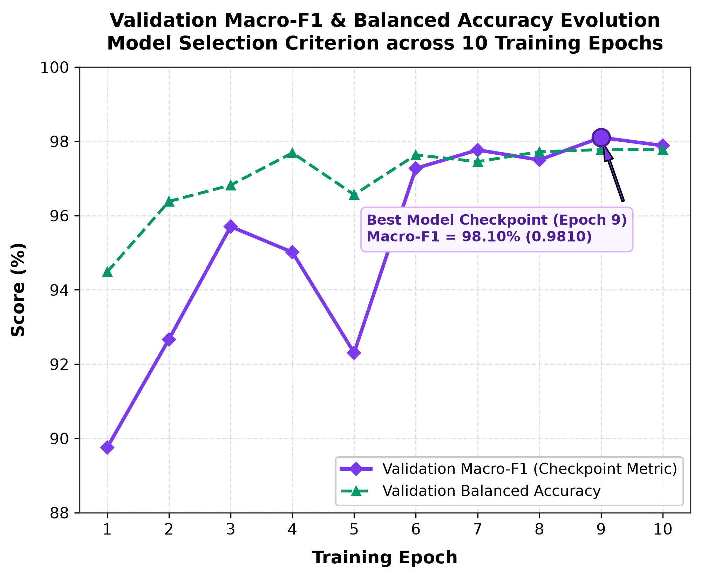

#### 4d. Grouped Diagnostic Performance Bar Chart
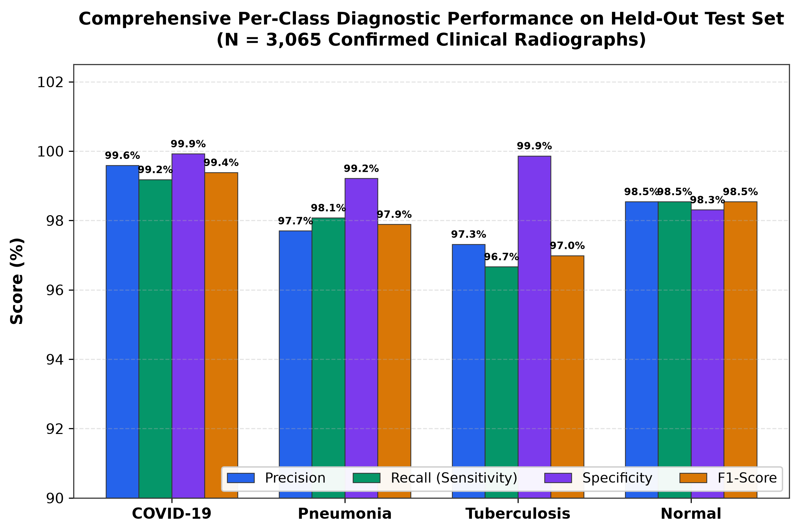

---

## 📊 Summary Performance Table on Held-Out Test Split ($N = 3,065$)

| Disease Class | Support | Precision | Sensitivity (Recall) | Specificity | F1-Score | ROC-AUC |
|---|---|---|---|---|---|---|
| **COVID-19** | 488 | **99.59%** | **99.18%** | **99.92%** | **99.38%** | **0.9999** |
| **Pneumonia** | 780 | **97.70%** | **98.08%** | **99.21%** | **97.89%** | **0.9992** |
| **Tuberculosis** | 150 | **97.32%** | **96.67%** | **99.86%** | **96.99%** | **0.9995** |
| **Normal** | 1,647 | **98.54%** | **98.54%** | **98.31%** | **98.54%** | **0.9988** |
| **Macro Average** | **3,065** | **98.29%** | **98.12%** | **99.33%** | **98.20%** | **0.9994** |
